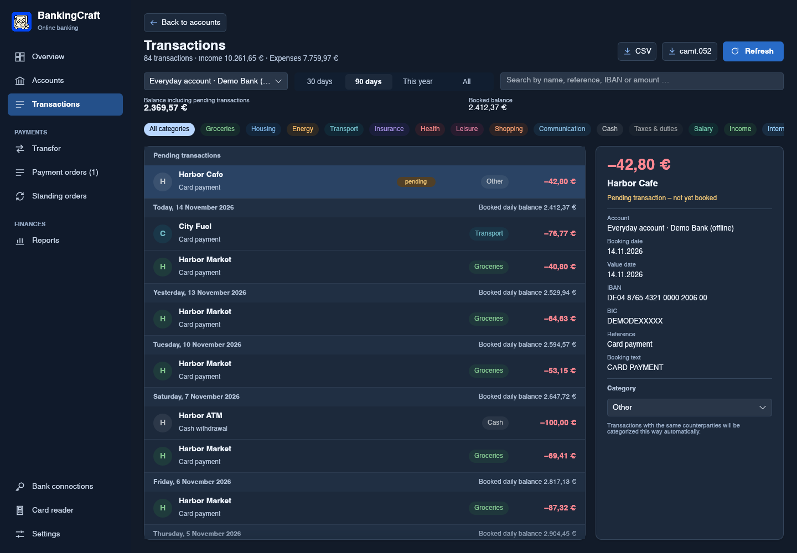
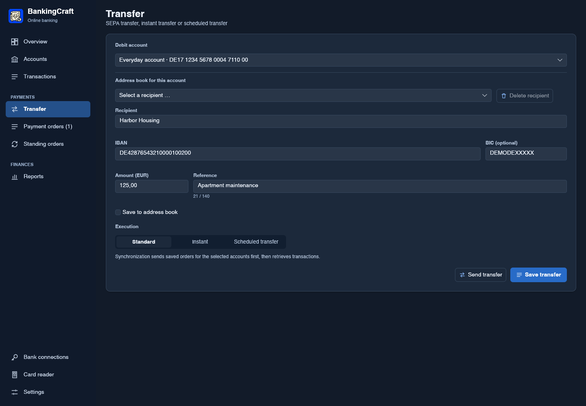
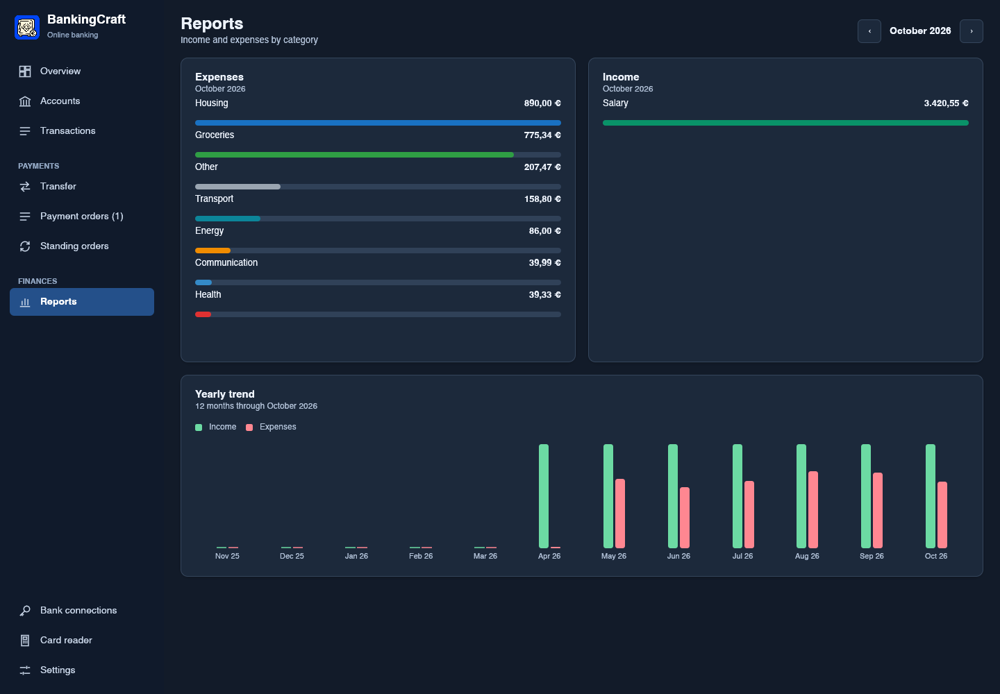

# BankingCraft – Desktop banking for Windows, Linux and macOS

BankingCraft is a Rust desktop banking application using **egui 0.36** and **eframe 0.36**: a navigation sidebar,
an account dashboard, transaction lists with daily balances, payment forms and financial reports.

> [!WARNING]
> **Early alpha — intended for evaluation and development.**
> BankingCraft has limited real-world validation and is not yet validated for general
> production banking or real payment submission. The implemented features below do not
> imply that every bank, security method or payment workflow has been tested successfully.

## Development status and known limitations

**So far, only Postbank access via PIN/TAN and VR Bank Nord access via an RDH smart card
have been tested successfully with real bank accounts. These retrieval flows work in the
tested setups.**

| Bank and access method | Confirmed working scope |
|---|---|
| Postbank — FinTS PIN/TAN | Account, balance and transaction retrieval, including credit card balances and transactions; confirmed on November 12, 2026 |
| VR Bank Nord — RDH-7 smart card | Account retrieval through the real bank/card connection; successful retrieval confirmed by the user on November 13, 2026 |

Other banks, RDH-9/10, DDV and other card/reader combinations have **not** been confirmed
through successful real-world tests. Simulator tests and protocol implementations do not
establish compatibility with untested banks or hardware.

Bank profiles were compared with AqBanking and current bank publications on
**November 13, 2026**. Setup hints, selected outdated endpoints, statement-format
negotiation and account-data handling have been updated. See the
[bank compatibility review](docs/bank-compatibility.md) for the per-bank sources,
remaining uncertainties (including Consorsbank's documented FinTS version) and
offline test coverage. **This does not expand the live-tested bank list above.**

- **FinTS product registration is pending.** BankingCraft does not yet have its own registered
  product ID. Normal builds without a configured ID send an unregistered placeholder and may
  be rejected by banks. The local test ID used during development is neither included in the
  repository nor embedded in builds. See [Build](#build) for the separation of local test settings.
- **Real payments remain untested.** Transfers, instant and scheduled transfers, standing order
  changes and Verification of Payee have not been validated by submitting real payment orders.
  Their automated tests use simulated bank responses.
- **The interface has just migrated to egui/eframe 0.36.** Automated UI tests and a native macOS
  startup check have passed, but broad hands-on validation is still pending. Some font rendering
  and spacing differ from the previous interface.
- **Platform validation is limited to macOS.** Windows and Linux are intended targets; the
  current application has not yet been validated on those platforms. Automated GitHub checks
  across all three platforms are still to be added.
- **Security testing is limited.** Passing tests and dependency scans are not an independent
  security audit or banking certification. A `SECURITY.md` and a documented confidential
  vulnerability-reporting channel are still to be added. Do not post credentials or bank data
  in public issues.
- **Release source packaging remains to be prepared.** Third-party license and attribution
  notices, including the LGPL-2.1 bank directory, are included in
  [THIRD_PARTY_NOTICES.md](THIRD_PARTY_NOTICES.md). Binary releases must also provide their
  matching corresponding source.
  Earlier security-review sections describe the previous Slint version and must be read with
  their dates; the current UI verification is documented in [docs/testing.md](docs/testing.md).

The application was previously called Kontor. Existing vaults are still found in their original
location; the file format, `vault.kontor` filename and key derivation remain compatible.

## Screenshots

The English interface with fictional demo accounts and transactions, rendered directly from
the application. The demo works offline; all names, account numbers and payments shown are test data.

### Financial overview

View balances including pending transactions alongside separately labelled booked balances,
recent transactions, spending categories and upcoming standing orders.


### Accounts and groups

Organize accounts into groups and retrieve transactions for an individual group.


### Transactions

Filter and search transactions, compare booked and pending-inclusive balances,
inspect pending entries and refresh the selected account.



### Transfers

Prepare a standard, instant or scheduled transfer with an account-specific recipient address book.



### Reports

Explore income and expenses by category and compare the yearly trend.



## License

BankingCraft is free software licensed under the **GNU General Public License, version 3**
(`GPL-3.0-only`). You may use, modify and redistribute it, including for commercial purposes,
under the terms of the [GPL v3](LICENSE). When distributing the application or modified versions,
you must comply with the GPL's corresponding-source and license-notice requirements.

BankingCraft is distributed without any warranty, including the implied warranties of
merchantability or fitness for a particular purpose, to the extent permitted by applicable law.
See [LICENSE](LICENSE) for the complete terms.

Third-party dependencies and bundled data retain their respective licenses. egui and eframe are
dual-licensed under MIT or Apache-2.0; the bank directory's source and license are described under
[Bank directory](#bank-directory). Full texts and attributions are collected in
[THIRD_PARTY_NOTICES.md](THIRD_PARTY_NOTICES.md) and [licenses/](licenses/).
This license change does not revoke rights already granted
for earlier copies under their previous licenses.

## Privacy and data transmission

BankingCraft does not collect or transmit telemetry or usage analytics. Personal and financial
data stays on your device and is not sent to the developers or other third parties. The only
exception is the data exchanged with your configured bank, including its banking service provider,
to authenticate, retrieve account information and submit banking orders. Banking data is stored
locally in the encrypted vault. Exports are saved locally; sharing an exported file is your choice.

## Features

| Area | Implementation |
|---|---|
| Current accounts | UPD account discovery, IBAN/BIC (HKSPA), booked and available balances (HKSAL v5–7), camt.052 transactions (HKCAZ) with MT940/MT942 fallback (HKKAZ v5–7), pending transactions, pagination and duplicate detection |
| Credit cards | HKKKU v1 / DKKKU v2 transactions; HKKKS v1 / DKKKS v3 balances or balances from transaction reports; account permissions, pagination, debit/credit and pending entries |
| PIN/TAN | FinTS 3.0, PSD2 SCA (HKTAN v6/v7, processes 4/2/S), system synchronization, TAN method/media selection and decoupled app approval |
| TAN display | Optical chipTAN with adjustable animated flicker code, photoTAN/QR-TAN images from HHDuc, SMS/text |
| chipTAN USB | HHDuc sent through `FEATURE_MCT_READER_DIRECT` (SCardControl) or `FF 91 06 00` APDU; TAN read back from the reader |
| HBCI smart cards (DDV) | DDV-0/DDV-1; bank details and signature counters read from the card; RIPEMD-160 and card-generated DES retail MAC; two-key 3DES CBC encryption; HBCI over TCP port 3000 |
| RDH smart cards | ZKA/SECCOS cards such as VR-NetWorld-Card, RDH-7/9/10 profiles, card notepad access, HKISA bank keys checked against the card hash, card-generated RSA-PSS signatures and signature counters, two-key 3DES and RSA key transport (PKCS#1 v1.5 for RDH-7/9, mode 2 for RDH-10), bank signature verification |
| Secure PIN entry | `FEATURE_VERIFY_PIN_DIRECT` for class 2/3 readers; the PIN stays on the reader. Software PIN entry is available only for readers without a PIN pad |
| Payments | SEPA transfers (HKCCS), instant transfers (HKIPZ), scheduled transfers (HKCSE), standing order creation/retrieval/deletion (HKCDE/HKCDB/HKCDL), pain.001.001.03/.001.003.03/.001.001.09 |
| Payment orders and recipients | Encrypted outgoing queue, automatic dispatch when the bank connection is synchronized, immediate sending on request, and a separate opt-in address book per account |
| Reports | Automatic categorization with learned rules, monthly and twelve-month reports |
| Export | CSV with translated headings and categories, semicolon delimiters and German number/date formatting; camt.052.001.08; files saved to Downloads |
| Bank directory | 2,787 institutions with PIN/TAN URLs or HBCI hosts; search by name, city, bank code or BIC, tolerant of German umlaut spelling; embedded in `app/data/banks.tsv` |
| Privacy | Local AES-256-GCM vault, key derived from the vault password using Argon2id; online banking PINs are saved only when explicitly requested and are additionally encrypted; card PINs are never saved |
| Appearance | Light and dark themes, applied immediately; the first launch follows the system theme |
| Languages | German, English, French and Spanish; the first launch uses the system language, with English as the fallback; the language can be changed in Settings |

## REINER SCT cyberJack (secoder)

Readers with “cyberJack” or “REINER SCT” in their PC/SC name are detected and preferred.
**Card reader → Check reader & card** shows the reported PC/SC Part 10 capabilities
(secure PIN entry, MCT/chipTAN USB, display), the inserted HBCI card and its bank connections.

The proprietary Secoder display of payment details during HBCI signing is not implemented.
For chipTAN USB, the reader displays payment details using the standard HHDuc mechanism.

Drivers: REINER SCT drivers on macOS and Windows; `pcscd` and `ifd-cyberjack` on Linux.

## Build

Requirements: Rust 1.95 or newer (tested with 1.99.1), a working OpenGL driver, and
Python 3 for license-bundle verification in the test and macOS packaging scripts, plus:

- **Linux:** `libpcsclite-dev`, `pcscd`, `libxkbcommon-dev`, `libfontconfig1-dev`, `libfreetype6-dev` (Debian/Ubuntu package names)
- **macOS:** Xcode Command Line Tools; PC/SC uses `PCSC.framework`
- **Windows:** no additional PC/SC package; WinSCard is part of Windows

System fonts are discovered with Fontique (Fontations) and rendered by egui using
`skrifa`. The existing font-family preferences and bundled fallback fonts are retained.
Linux Wayland title bars use winit's Crossfont/FreeType backend to avoid the unmaintained
`ttf-parser` dependency while retaining window decorations and title text.
The small `crates/crossfont-compat` re-export bridges winit 0.30's Crossfont 0.8
requirement to Crossfont 0.9, so it shares Fontconfig's version 6 binding with Fontique.

```sh
cargo build --release
./target/release/bankingcraft          # Windows: target\release\bankingcraft.exe
```

**macOS application:** double-click `macos/build-macos.command`. It builds `BankingCraft.app`
next to the project directory, includes the icon, applies an ad-hoc signature and launches the app.

A product ID already configured in a vault takes precedence. Normal builds use only that
setting; otherwise the client sends the unregistered placeholder `BANKINGCRAFT`.
Product IDs are not embedded through build environment variables.

For local tests only, build with `cargo build --release --locked --features local-fints-test`.
This opt-in build can read a fallback ID at runtime from
`BankingCraft/local-tests/fints-product-id` inside the current user's OS configuration directory
(macOS: `~/Library/Application Support/BankingCraft/local-tests/fints-product-id`).
Keep this file outside the repository with permissions `0600`; its contents must never appear
in source, examples, documentation or commits. The ID is neither compiled into the app nor
saved to a vault. A configured vault ID always takes precedence. Normal builds ignore this file;
copying the test app to another machine does not copy its local configuration.
The former `BANKINGCRAFT_DEFAULT_PRODUCT_ID` build variable is no longer used.

Set `RUST_LOG=debug` for protocol diagnostics. Message contents and PINs/TANs are not logged.
Error reports contain technical segment summaries, without free-form bank messages.

## Getting started

1. Set a vault password.
2. Open **Bank connections → New bank connection** and find the bank by name, city,
   bank code or BIC. The bank code and FinTS URL or HBCI host are filled in automatically.
   Enter the PIN/TAN user ID, or select a smart card reader and choose **Read data from card**.
3. Choose **Retrieve transactions** on the overview page.

On **Transactions**, **Refresh** retrieves only the balance and transactions of the selected
account. It does not send queued payments. Selecting **All accounts** explicitly retains the
full account refresh. **Back to accounts** at the top left returns to the account list.

[FinTS product registration](https://www.fints.org/de/hersteller/produktregistrierung) is handled
by the software publisher. Once assigned, BankingCraft’s product ID will be embedded in a future
release. Product registration fields are not shown in Settings.

Without a bank connection, **Load demo data** creates a local demo connection. Demo transfers
show a sample flicker code and are simulated locally; they do not contact a bank.

**Save transfer** is the default payment action, including Enter in the transfer fields. It adds
the transfer to **Payment orders** without contacting the bank. Synchronizing the corresponding
bank connection, individually or in the account refresh, sends its saved orders with the normal
bank authorization. **Send transfer** sends only the current transfer immediately after confirmation.
Sent orders remain visible in the list and are not sent again. Interrupted or failed attempts are
marked **Review required** and are not retried automatically; check the bank status before creating
a replacement. Removing a local entry does not cancel an order already received by the bank.

Each account has its own recipient address book. Select a recipient to fill in name, IBAN and BIC.
A recipient is saved or updated only when **Save to address book** is checked when saving or sending
the transfer. The checkbox is off by default and resets after a successful payment action or account
change. The same IBAN updates a recipient only in that account. Existing vaults remain compatible.

Window size and position are saved when the window closes or the application quits and restored
on the next launch, including the locked screen. `window-state.json` next to the vault contains
only window preferences. If a previous monitor is unavailable, the window is moved to an accessible
screen. On Wayland, the compositor may restrict restoring absolute window positions.

Under **Settings → Appearance**, choose **System setting**, **Light** or **Dark**.
Without a saved choice, the application follows the system, including later theme changes.
A manual choice takes effect immediately and is stored in `appearance.json` next to the vault.
It also applies to the unlock screen; the file contains no banking or credential data.

Under **Settings → Language**, choose **System setting**, **Deutsch**, **English**, **Français**
or **Español**. On the first launch, the application uses the primary system language; regional
variants such as `fr-CA` and `es-MX` are recognized. Unsupported or unavailable languages fall back
to English. The selection takes effect immediately and is saved in `language.json` next to the vault,
so it also applies before unlocking on the next launch. System mode resolves the system language
at startup. User-created group names, account names and bank-supplied transaction descriptions
remain unchanged. Category IDs and payment data remain stable across language changes.
Numeric dates and financial amounts retain their existing input/output conventions.

## Multiple vaults

The startup password dialog lets you choose a recent vault, **Open vault…** from a file,
or **Create a new vault…** with its own filename and password. The last successfully opened
vault is selected on the next launch; the original `vault.kontor` remains discoverable.
Under **Settings → Vaults → Switch / create vault**, the same selection is available while
working. The active vault's name is shown in the window title and Settings.

Each vault is a separate encrypted `.kontor` file. Creating a vault never overwrites an existing
file. Canceling or entering a wrong password preserves the current session; a successful switch
clears unsaved forms and previous selections. Switching waits until bank operations and their
UI updates are complete. Existing data is saved before switching, and a save failure keeps the
current vault open. `vaults.json` in the original application data directory stores only recent
file paths, without passwords or banking data. Appearance, language and window preferences
remain application-wide. The one-time Bank X import only applies to the original default vault.

## Account display names

Long account names wrap in the overview and account list. Under **Accounts → Change display name**,
set a local name or leave the field blank to use the bank's name again. The display name is encrypted
with the vault, survives bank refreshes, and appears in account selectors, transactions and payments.
The bank's original product name and the account details used for banking remain unchanged.

## Account groups

Create groups under **Accounts**. To rename a group, edit its name and press Enter to save.
Each group's **Refresh transactions** button retrieves only that group's accounts, using one
bank dialog per connection. This also works for **Ungrouped** and does not send queued payments.
Assign an account using its group selector; **Ungrouped** removes the assignment.
Groups are encrypted along with the vault.

On the overview, **Recent transactions**, **Expenses by category**, **Income & expenses** and
**Upcoming standing orders** each have their own group selector. Choose **All accounts**,
**Ungrouped** or a named group. Each choice affects only its tile and is retained while working
in the current vault, including after group renaming or account updates. Switching vaults or
restarting the app resets the selectors to **All accounts**.

The overview shows each group’s known booked balances, separately by currency. Missing balances
are marked as missing rather than treated as zero. Drag accounts within the overview account list
to reorder them; an insertion line shows the destination. The order survives application restarts
and account refreshes, and sorting preserves group assignments.

Standing order retrieval negotiates HKCDB version 1 or 2 and the bank’s supported pain.001 formats.
Version 2 also supplies execution times. Failed retrievals preserve existing standing orders and
are reported as failures or partial successes.

## Project layout

```
crates/fints         FinTS 3.0 syntax, messages, PIN/TAN/DDV/RDH security, BPD/UPD,
                     banking operations, MT940, camt.052, pain.001 and flicker codes
crates/cardreader    PC/SC, DDV/RDH smart cards, chipTAN USB, PIN pads and diagnostics
crates/i18n          Shared translation catalogue, locale resolution and runtime messages
crates/i18n-macros   Compile-time checked translated format strings
app                  egui/eframe UI, encrypted vault, categorization and background jobs
```

`crates/i18n/catalogue.json` is the translation source of truth. Each German source string maps
to English, French and Spanish translations. Translations are compiled into the application;
Rust format strings are checked by the compiler in every language. Add new user-facing text
to this catalogue and use `i18n::tr` or `i18n::tr_format!`. Do not translate protocol values,
persisted identifiers or user/bank-supplied text. Keep this README and commit messages in English.

## Bank directory

`app/data/banks.tsv` originates from the `blz.properties` file in
[hbci4java](https://github.com/hbci4j/hbci4java) (LGPL-2.1, October 2026 snapshot).
Old endpoints were updated: `hbci-pintan.gad.de` to `fints1.atruvia.de`, `hbci11.fiducia.de` to
`fints2.atruvia.de`, and former Dresdner Bank addresses to Commerzbank. The bank’s own information
remains authoritative; the endpoint can be edited in the connection form.
The [LGPL-2.1 license text](licenses/bank-directory/LGPL-2.1.txt), provenance and
modification notice are included in [THIRD_PARTY_NOTICES.md](THIRD_PARTY_NOTICES.md#bank-directory-from-hbci4java).

## Compatibility with AqBanking/GnuCash

Message structure and dialog flow follow AqBanking, the FinTS library used by GnuCash
(behavior reimplemented; no AqBanking source code copied):

- System IDs obtained with a single-step dialog: method 999, security profile `PIN:1`, no HKTAN.
  Two-step dialogs use `PIN:2` and HKTAN processes 4 → 2/S.
- The TAN medium, such as a BestSign device, is placed in HKTAN field 11 in every process step.
- HKVVB protocol dialog language remains 1, independently of the UI language. SEPA orders use
  complete KTI data; HKCDB/HKCDL field ordering follows AqBanking.
- Decoupled approval uses HKTAN process S, detected through HITANS or return code 3955.

### RDH smart cards compared with AqBanking/GnuCash

**Review updated November 13, 2026: full equivalence has not been established.** GnuCash uses
AqBanking/AqHBCI and libchipcard for ZKA cards. BankingCraft reimplements part of this functionality in Rust.

| Area | BankingCraft after review |
|---|---|
| RDH-7/9/10 cryptography | SHA-256/SHA-256, RSA-PSS, two-key 3DES and profile-specific RSA key transport; tested locally with RSA-2048 |
| Response validation | Personalized RDH responses must be fully encrypted and validly signed. Missing keys/signatures, inconsistent control references and unprotected additional segments are rejected |
| Card access | ZKA/SECCOS notepad, private keys, fresh signature counter and PIN pad; corrected EF_KEYD descriptors and extended APDU lengths |
| Trust | Bank keys checked against the card hash or explicitly verified by the user; no automatic acceptance of unverified keys |
| Scope | Previously initialized RDH smart cards; no software key files, initial INI setup, key changes/revocation or certificate workflows |
| Real-world validation | Successful VR Bank Nord retrieval using an RDH-7 smart card, confirmed by the user on November 13, 2026; other profiles and card/reader combinations remain unverified |

Findings, sources, fixes and test limits: [RDH code review](docs/rdh-review.md).

## Verification

Run the offline regression suite with `./scripts/test-business.sh`. Test cases and limitations are
listed in [docs/testing.md](docs/testing.md). The [security review](docs/security-review.md) covers
fixes, the dependency scan and remaining limitations.

- Flicker code generation matches all six reference vectors from the hbci4java test suite.
- Tests cover message structure, escaping, binary data, MT940/SEPA fields, pain.001 round trips and IBAN validation.
- DDV and chipTAN USB APDU sequences follow the hbci4java `smartcardio` implementation.
- A complete RDH-7 dialog is tested against a simulated bank using real RSA-2048 keys: key retrieval,
  hash validation, synchronization, signing, encryption and bank signature verification. Card layouts
  such as the notepad, EF_KEYD and PIN formats use test fixtures.
- **Postbank PIN/TAN:** real account, balance and transaction retrieval succeeded on November 12, 2026
  after the camt fix; credit card balances and transactions were also retrieved successfully.
- **VR Bank Nord RDH-7:** the user confirmed successful retrieval with the real bank/card
  connection on November 13, 2026. This does not validate other banks, RDH-9/10 or other
  card/reader combinations.
- **Only these two bank/access combinations have been confirmed working with real bank accounts.**
- No real payment orders have been submitted for testing.
- Language tests cover first-start detection, English fallback, persistence, all four bundled UI
  languages, translated format placeholders, stable categories and unchanged account/group/form data.
- Direct debit reversal is not implemented. Standing orders are changed by deleting and recreating them.

### Verification of Payee

Standard, instant and scheduled transfers use the bank's FinTS Verification of Payee service
(HKVPP/HIVPP, version 1). Before authorization, BankingCraft displays the result for the submitted
name and IBAN together with the complete bank message. For a close match, the recipient name
reported by the receiving bank is shown and can be copied. To make a correction, cancel and check
the revised payment again. For a mismatch or an unavailable check, continuing requires explicit
acknowledgement. A missing result is never presented as a match.

Further submission follows the bank's response codes: continue the existing TAN authorization
for code 3091; otherwise resubmit the identical payment with HKVPA and the bank's VoP ID.
Smart cards always require the second submission. Queued payment orders use the same flow;
payments are never retried automatically. Standing order creation uses the check when the bank
advertises support for it in its parameters. If the bank offers no supported verification flow
for transfers, authorization remains blocked and the app directs the user to the bank's online
banking service. Explicit execution by the bank without further authorization (3091 + 3076)
is shown as already completed. Demo mode clearly indicates that no bank verification took place.

References: [FinTS specification, VoP V1.02 dated October 19, 2026](https://www.fints.org/de/spezifikation/aenderungen)
and [DK Annex 3 V3.9, section 2.2.6, pain.002.001.10](https://www.ebics.de/de/datenformate/gueltige-version).
Verification is tested with simulated bank responses; real bank and hardware tests are outside
the scope of the offline suite.
