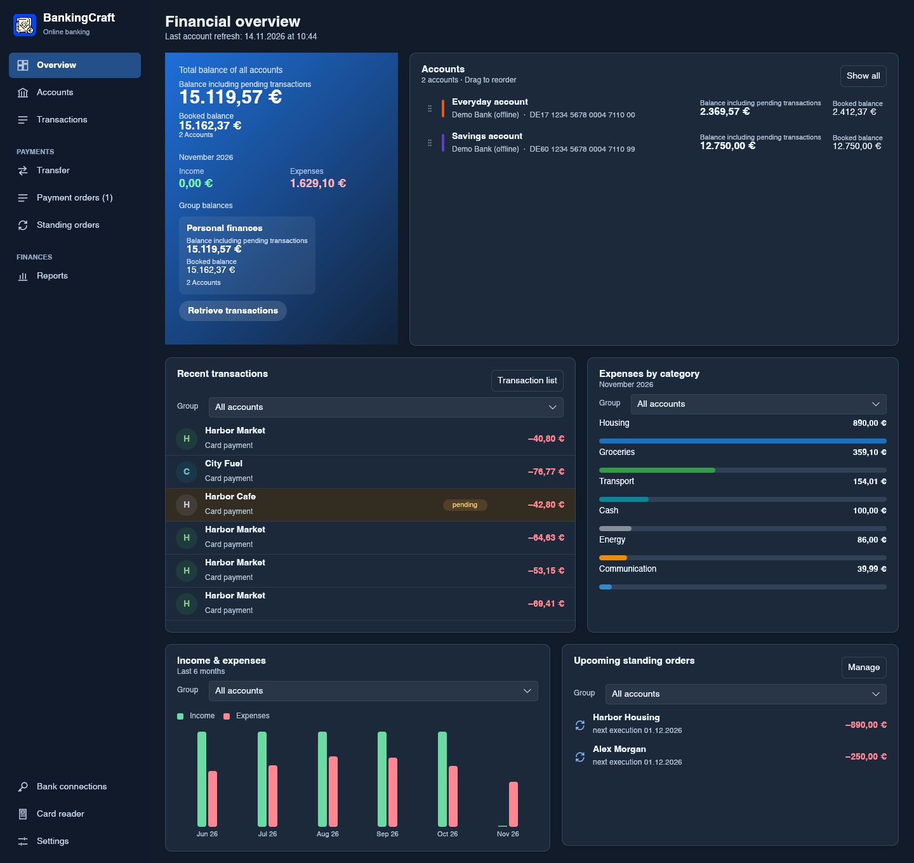
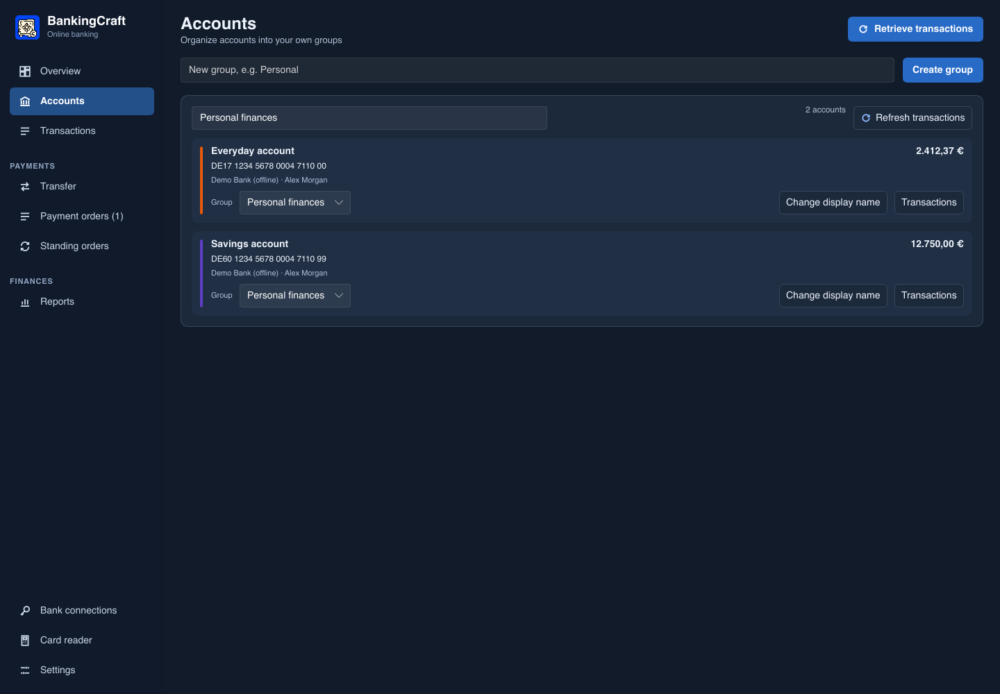
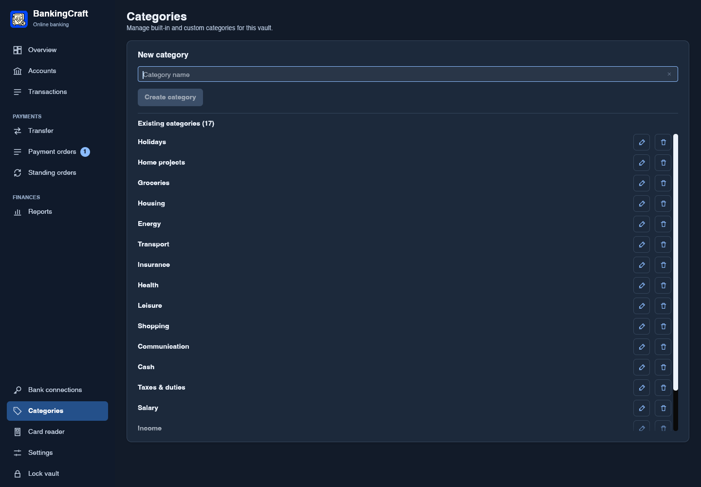

# BankingCraft – Desktop banking for Windows, Linux and macOS

BankingCraft is a Rust desktop banking application using **egui 0.36** and **eframe 0.36**.
FinTS/HBCI banking is handled by **AqBanking**, with **Libchipcard** for smart cards and
chipTAN USB. The app provides encrypted local vaults, account and credit-card retrieval,
transaction lists, editable categories, payment workflows and financial reports. PayPal retrieval uses a
separate experimental read-only integration.

> [!WARNING]
> **Early alpha — intended for evaluation and development.**
> BankingCraft has limited real-world validation and is not yet validated for general
> production banking. The implemented features below do not
> imply that every bank, security method or payment workflow has been tested successfully.

## Development status and known limitations

**The current backend uses AqBanking 6.9.2, Gwenhywfar 5.14.3 and Libchipcard
5.1.6. Postbank PIN/TAN account, balance and transaction retrieval, including
credit-card transactions, completed successfully on macOS on November 15, 2026.
A VR Bank Nord RDH retrieval was also exercised with a cyberJack; the user confirmed
one reader PIN entry for the refresh. During local testing on November 17, the user
reported a bank-accepted Postbank transfer. This is limited user-reported evidence,
not independent confirmation of settlement or validation of other payment methods
and card/reader combinations.**

Other bank/card configurations must be validated separately. The application remains
an evaluation build.
See [native banking](docs/native-banking.md) and the
[security implementation and audit handoff](docs/security-hardening.md).

- **BankingCraft uses its own registered FinTS product ID.** It is included in normal builds
  and sent only in HKVVB's “Produktbezeichnung” field, unchanged and exactly 25 characters long.
  Activation may still vary by bank. Registration does not replace bank/card compatibility checks.
- **PayPal retrieval is experimental and has not been tested with a real account.** It requires
  an eligible PayPal Business account with legacy NVP API signature credentials. Read-only
  balance and transaction retrieval is implemented; see [PayPal setup](#paypal-setup).
- **Payment validation remains limited.** Automated transfer, standing-order and Verification
  of Payee checks use simulated bank responses. The user-reported Postbank acceptance above
  does not validate every bank, payment method or final settlement. **Synchronize accounts sends saved
  orders for the selected accounts before retrieving balances and transactions.**
- **The interface uses egui/eframe 0.36.** Automated UI tests and a native macOS
  startup check have passed, but broad hands-on validation is still pending.
- **Interactive platform validation is limited to macOS.** GitHub CI is configured to test, lint
  and build normal releases on macOS, Windows and Linux. This does not replace hands-on
  validation with real readers, graphics drivers or bank connections on each platform.
- **Security testing is limited.** Passing tests and dependency scans are not an independent
  security audit or banking certification. See [SECURITY.md](SECURITY.md) for confidential
  reporting through GitHub. Private vulnerability reporting must be enabled by the maintainer.
  Do not post vulnerabilities, credentials or bank data in public issues.
- **Packaged alpha releases** are built on GitHub Actions as a Linux AppImage, a Windows
  EXE installer/portable ZIP and an ARM64 macOS DMG for Apple Silicon. Starting with 0.1.1,
  releases no longer include an Intel Mac package. Each release includes
  matching source with vendored Rust dependencies, license notices and SHA-256 checksums.
  See [downloads and release instructions](docs/releases.md).
  Current verification is documented in [docs/testing.md](docs/testing.md).

Existing vaults are found in their original location; the file format, `vault.kontor`
filename and key derivation remain compatible.

## Downloads

Get the [0.2.0 alpha release](https://github.com/SvenCarstensen/BankingCraft/releases/tag/v0.2.0)
for Linux x64, Windows x64 or Apple Silicon Macs. Version 0.2.0 adds Postbank BestSign
status polling, batched chip-card retrieval, activity history, account-specific transfer
templates and macOS notifications with a quiet chime.
The existing [0.1.0 Intel download](https://github.com/SvenCarstensen/BankingCraft/releases/tag/v0.1.0)
remains available unchanged. The macOS app and DMG are Developer ID signed and Apple notarized.
The signing identity is **Sven Carstensen (Y322FFQ9N6)**, the authorized Apple account;
AppCreation GmbH remains the app's publisher. Windows packages are not Authenticode signed.

See the [0.2.0 release notes](docs/release-notes.md) and
[installation instructions](docs/releases.md) for package choices, signature verification
and platform requirements. Existing vaults remain compatible; the alpha limitations above
still apply. Earlier `v0.0.10` downloads do not contain these backend and signing updates.

## Screenshots

The English interface with fictional demo accounts and transactions, rendered directly from
the application. The demo works offline; all names, account numbers and payments shown are test data.

### Financial overview

View balances including pending transactions alongside separately labelled booked balances,
recent transactions, spending categories and upcoming standing orders. Cards in the same
row share a height that adapts to their contents, including after group-filter changes.



### Accounts and groups

Organize accounts into groups and retrieve transactions for an individual group.



### Transactions

Filter and search transactions, compare booked and pending-inclusive balances,
inspect pending entries and refresh the selected account.


### Transfers

Prepare a standard, instant or scheduled transfer with an account-specific recipient address book.


### Reports

Explore income and expenses by category and compare the yearly trend.


### Category management

Create categories and rename or delete built-in and custom categories from a dedicated
sidebar page. Pencil and trash icons sit beside each category name.



## License

BankingCraft is free software licensed under the **GNU General Public License, version 3**
(`GPL-3.0-only`). You may use, modify and redistribute it, including for commercial purposes,
under the terms of the [GPL v3](LICENSE). When distributing the application or modified versions,
you must comply with the GPL's corresponding-source and license-notice requirements.

BankingCraft is distributed without any warranty, including the implied warranties of
merchantability or fitness for a particular purpose, to the extent permitted by applicable law.
See [LICENSE](LICENSE) for the complete terms.

Third-party dependencies and bundled data retain their respective licenses. egui and eframe are
dual-licensed under MIT or Apache-2.0; the bank directory's source and license are described under
[Bank directory](#bank-directory). Full texts and attributions are collected in
[THIRD_PARTY_NOTICES.md](THIRD_PARTY_NOTICES.md) and [licenses/](licenses/).
This license change does not revoke rights already granted
for earlier copies under their previous licenses.

## Privacy and data transmission

BankingCraft does not collect or transmit telemetry or usage analytics. Personal and financial
data stays on your device and is not sent to the developers or other third parties. The only
exception is the data exchanged with your configured bank (including its banking service provider)
or PayPal to authenticate and retrieve account information, and with your bank to submit orders. Banking data is stored
locally in the encrypted vault. Exports are saved locally; sharing an exported file is your choice.

## Features

| Area | Implementation |
|---|---|
| Current accounts | AqBanking account discovery, balances and transaction retrieval, with normalized duplicate detection across the backend migration |
| Credit cards | Retrieval through AqBanking where the account advertises support; Postbank retrieval confirmed on macOS, other banks unverified |
| Synchronization | Account, group or complete-bank refresh; progress shows the current account and whether balances or transactions are being retrieved; persistent errors with selectable details |
| PayPal | Read-only NVP API signature access, live/sandbox endpoints, available balances per currency, signed net transactions including fees, bounded date-range splitting at the 100-result limit; credentials encrypted in the vault |
| PIN/TAN | AqBanking handles FinTS, synchronization, TAN method/media selection and bank authorization |
| TAN display | Native AqBanking optical HHD data, bounded photoTAN/QR images, text and app approval prompts |
| chipTAN USB | Libchipcard generates the TAN; BankingCraft validates the bounded response |
| HBCI smart cards | DDV and ZKA/RDH through AqBanking and Libchipcard crypt tokens; private keys remain on the card |
| Secure PIN entry | Libchipcard handles reader PIN-pad capabilities; a shared card session and batched reads reduce repeated reader/network work. A reader PIN dialog shows a 30-second countdown and aborts the operation on timeout. |
| Postbank BestSign | Push approval with automatic status polling when advertised by the bank; the same dialog shows progress and the final result. Polling does not submit the transfer again. |
| Balance completeness | Securities accounts without a balance remain visible but do not trigger a missing-account-balance warning; depot holdings and valuations are not retrieved |
| Payments | AqBanking SEPA transfers, scheduled transfers and standing order operations; availability follows account capabilities; full local confirmation before submission |
| Payment orders and recipients | Encrypted outgoing queue showing pending/unresolved orders, automatically removing bank-accepted orders from the list (including previously sent orders), a navigation badge counting visible orders (hidden when empty), saved orders sent before transaction retrieval for the selected accounts, immediate sending on request, and a separate opt-in address book per account |
| Local notifications (macOS) | A quiet bundled chime and a local banner signal sync completion (success, errors or cancellation) and a new card-reader input prompt. Countdown updates do not repeat alerts; completed/expired reader prompts are removed. Uses the macOS notification permission and sound settings, with fixed text excluding banking details. [Apple notification sound documentation](https://developer.apple.com/documentation/usernotifications/unnotificationsound) |
| Activity history | Encrypted per-vault history of bank jobs, payment outcomes, local changes, imports/exports and session actions, with search, message-type filters and time/type sorting. Text wraps fully without truncation. Transfer details can prepare a new draft for review and authorization. Existing accepted orders are imported with an explicit unknown-confirmation-time note; other earlier actions cannot be reconstructed. Raw bank replies, credentials, PINs and TANs are excluded. |
| Transfer templates | Named templates per debtor account include recipient, amount and payment reference. Loading a template only fills the form; execution dates and previous payment identifiers are not reused. |
| Reports | Automatic categorization with learned rules, monthly and twelve-month EUR reports; other currencies remain separate in transaction lists and balance totals |
| Categories | A dedicated sidebar page below Bank connections; create categories, rename or delete custom and built-in categories per vault, with preserved assignments and a replacement for deleted categories |
| Export | CSV with translated headings and categories, semicolon delimiters and German number/date formatting; camt.052.001.08; files saved to Downloads |
| Bank directory | 2,787 institutions with PIN/TAN URLs or HBCI hosts; search by name, city, bank code or BIC, tolerant of German umlaut spelling; embedded in `app/data/banks.tsv` |
| Privacy | Local AES-256-GCM vault, key derived from the vault password using Argon2id; online banking PINs are saved only when explicitly requested and are additionally encrypted; card PINs are never saved |
| Session protection | Manual lock, five-minute idle expiry, system-lock/resume monitoring, prompt revocation and exclusive vault access; platform limits documented in the security review |
| Appearance | Light and dark themes, applied immediately; the first launch follows the system theme; overview cards in each row share the same height; Lock vault sits last in the sidebar with a lock icon and the same hover highlight as other menu items |
| Languages | German, English, French and Spanish; the first launch uses the system language, with English as the fallback; the language can be changed in Settings |

## Categories

Open **Categories** in the sidebar, directly below **Bank connections**. The page is also
linked from Settings and from a transaction's category selector. Both built-in and custom
categories can be renamed or deleted using the pencil and trash icons beside each name.
New categories are available in transaction filters,
reports and CSV exports. User-defined names stay as entered when the interface language changes.

Renaming a built-in category preserves its automatic matching rules and color. Before
deleting any category, choose a replacement; existing assignments, learned rules and future
automatic matches use that replacement. Transactions are retained. At least one category
must remain available; create another category first if there is no suitable replacement.
All category settings are stored inside the encrypted vault, separately for each vault.

## REINER SCT cyberJack (secoder)

Readers with “cyberJack” or “REINER SCT” in their PC/SC name are detected and preferred.
**Card reader → Check reader & card** shows the PC/SC reader inventory and card presence.
Bank details are read by Libchipcard when configuring the card access.

The proprietary Secoder display of payment details during HBCI signing is not implemented.
For chipTAN USB, the reader displays payment details using the standard HHDuc mechanism.

Drivers: REINER SCT drivers on macOS and Windows; `pcscd` and `ifd-cyberjack` on Linux.

## Build

Build on the operating system you intend to run. For local development and replacing a local
installation, use `cargo build --locked -p bankingcraft` and the `target/debug` executable.
Local builds do not use Developer ID signing, Apple notarization or uploads to Apple;
only technically required local ad-hoc Mach-O signatures are used. The release commands
below are for explicitly requested distribution builds. They use **Rust 1.99.1**,
the version used by CI, and the committed lockfile. Install [Rust through rustup](https://rust-lang.org/tools/install/),
Git and Python 3 first. Reopen your terminal after installing tools so they are on `PATH`.
A working graphics driver with OpenGL support is required to run the native app.
No bank credentials, card reader or FinTS product ID are needed to compile or use demo data.
Banking operations require the native runtime beside the executable, including in release
builds. Build it with `scripts/build-native.py` and package it with `scripts/package-native.py`.
Full platform prerequisites and the MSYS2 Windows steps are in [native banking](docs/native-banking.md).

### macOS

Install Apple's Command Line Tools (compiler, linker and SDK) if needed:

```sh
xcode-select --install
```

After installing Rust, Python 3 and Homebrew, install the native prerequisites:

```sh
brew install pkg-config gettext gnutls libgcrypt gmp libxml2 libxmlsec1
```

Then run:

```sh
git clone https://github.com/SvenCarstensen/BankingCraft.git
cd BankingCraft
rustup toolchain install 1.99.1 --profile minimal --component clippy
rustup override set 1.99.1
python3 scripts/update-licenses.py --check
python3 scripts/build-native.py
cargo build --release --locked -p bankingcraft
python3 scripts/package-native.py target/release
./target/release/bankingcraft
```

For a double-clickable application bundle, use the included packaging script instead:

```sh
bash macos/build-macos.command
```

It builds `BankingCraft.app` **next to the repository directory**, includes the icon and
license bundle, applies a local ad-hoc signature and launches the app. It replaces an
existing bundle at that location and quits a running BankingCraft instance. The bundle
is not notarized or signed with an Apple Developer distribution certificate.
The build targets your Mac's architecture; this script does not produce a universal binary.
PC/SC uses macOS's `PCSC.framework`. A compatible reader may still require its vendor driver.

### Windows

Install Git, Python 3 and rustup. When prompted by rustup, install the
[Visual Studio C++ build tools](https://rust-lang.github.io/rustup/installation/windows-msvc.html)
with **Desktop development with C++** and a Windows SDK. Use the native **MSVC** Rust
toolchain; the following commands target x64 Windows in PowerShell, not WSL:

```powershell
git clone https://github.com/SvenCarstensen/BankingCraft.git
Set-Location BankingCraft
rustup toolchain install 1.99.1-x86_64-pc-windows-msvc --profile minimal --component clippy
rustup override set 1.99.1-x86_64-pc-windows-msvc
py -3 scripts/update-licenses.py --check
# Build/package the native runtime in MSYS2 as described in docs/native-banking.md.
cargo build --release --locked -p bankingcraft
.\target\release\bankingcraft.exe
```

The executable is `target\release\bankingcraft.exe`. The [release workflow](docs/releases.md)
creates an EXE installer and portable ZIP. WinSCard is supplied by Windows; no separate PC/SC development
package is needed. Install your reader's driver separately if required. If `py` is not
available, use `python` after confirming that `python --version` reports Python 3.

### Linux (Ubuntu 24.04 / Debian-style packages)

Install the compiler, development libraries and runtime components:

```sh
sudo apt-get update
sudo apt-get install -y build-essential pkg-config git curl python3 \
  libpcsclite-dev pcscd libxkbcommon-dev libxkbcommon-x11-dev libfontconfig1-dev libfreetype6-dev \
  libx11-dev libxi-dev libxrandr-dev libxcursor-dev libxinerama-dev \
  libgl1 fonts-noto-core gettext libgnutls28-dev libgcrypt20-dev libgmp-dev \
  libxml2-dev libxmlsec1-dev patchelf
```

Install Rust through rustup, then build and run from a graphical desktop session:

```sh
git clone https://github.com/SvenCarstensen/BankingCraft.git
cd BankingCraft
rustup toolchain install 1.99.1 --profile minimal --component clippy
rustup override set 1.99.1
python3 scripts/update-licenses.py --check
python3 scripts/build-native.py
cargo build --release --locked -p bankingcraft
python3 scripts/package-native.py target/release
./target/release/bankingcraft
```

Other distributions need equivalent development packages; package names differ. X11 and
Wayland are enabled. For smart-card access on a systemd machine, start the PC/SC socket
if your distribution has not already enabled it:

```sh
sudo systemctl enable --now pcscd.socket
```

Install a compatible reader driver, such as the distribution's cyberJack driver where
applicable. PIN/TAN and PayPal do not require a connected reader. The executable is
`target/release/bankingcraft`; the [release workflow](docs/releases.md) produces an AppImage.

### Tests, troubleshooting and redistribution

On every platform, from the repository root:

```sh
cargo test --workspace --locked
cargo clippy --workspace --all-targets --locked -- -D warnings
```

On macOS/Linux, `./scripts/test-business.sh` also verifies the license bundle first.
On Windows, run `py -3 scripts/update-licenses.py --check` before the Cargo commands.
The tests use synthetic data. See [Testing](docs/testing.md) for coverage and optional
screenshot exports. Native runtime validation is strongest on macOS; CI builds and
tests the Windows/Linux targets but does not validate their real readers or bank access.

If `cargo` or `rustup` is not found, reopen the terminal and check rustup's `PATH` setup.
On Windows, linker errors usually require the C++ workload/SDK. On Linux, missing
`libpcsclite`, `fontconfig`, `freetype` or `xkbcommon` errors indicate missing development
packages or `pkg-config`. See the [Rust installation guide](https://doc.rust-lang.org/book/ch01-01-installation.html).

When distributing binaries, include `LICENSE`, `THIRD_PARTY_NOTICES.md` and the
`licenses/` directory, plus the matching corresponding source required by the applicable
licenses. All release packaging scripts copy the reviewed notices and editable bank data.
Tagged releases also include a source archive with locked Rust dependency sources. See [license notices](THIRD_PARTY_NOTICES.md).

System fonts are discovered with Fontique and rendered by egui using `skrifa`.
Wayland title bars use Crossfont/FreeType. The local `crates/crossfont-compat` re-export
aligns winit's Crossfont dependency with Fontique's Fontconfig binding; it does not
introduce a separate renderer or `ttf-parser`.

### FinTS product registration

`crates/aqbanking/src/product.rs` supplies BankingCraft's registered product identity for
every PIN/TAN, DDV and RDH client. Legacy vault product fields are ignored.

For the explicitly requested temporary local installation, `local-fints-test` reads
`BankingCraft/local-tests/fints-product-id` from the current user's configuration
directory (macOS: `~/Library/Application Support/BankingCraft/local-tests/fints-product-id`).
This build requires a valid 25-character ASCII alphanumeric ID; a missing or invalid
file stops the operation without falling back to the publisher's ID. The temporary
ID is never compiled into the binary or saved in a vault. Normal builds ignore the
file and use BankingCraft's own registration. Keep the local file outside Git with
permissions `0600`.

The complete registration number is used exclusively in HKVVB's “Produktbezeichnung”
field. There are no prefixes, suffixes, truncation or use in another protocol field.
The native worker rejects registration values that are not exactly 25 ASCII alphanumeric
characters before initializing AqBanking. Application names, INI letters and log metadata
use “BankingCraft”. Raw banking logs remain disabled.

The separate HKVVB application version comes from the build, with five decimal digits:
one for major, two for minor and two for patch (for example, 0.0.10 becomes `00010`).
Old vault versions cannot replace either protocol field. No registration setup is required
in Settings or on individual machines.

Raw FinTS protocol logs are disabled. Application diagnostics retain warning/error metadata
without formatted messages or panic payloads. Bank errors remain visible in the app through
**Show details**, with an explicit copy action; redact personal data before sharing them.

## Automated checks

[CI](https://github.com/SvenCarstensen/BankingCraft/actions/workflows/ci.yml) runs license-bundle
verification, all workspace tests, Clippy with warnings treated as errors, and a normal release
build on macOS, Windows and Linux for pushes and pull requests. It uses Rust 1.99.1, synthetic
data and mocked bank responses. No bank credentials or local test product ID are supplied.

The [dependency audit](https://github.com/SvenCarstensen/BankingCraft/actions/workflows/dependencies.yml)
checks current RustSec advisories on pushes, pull requests and every week. Known vulnerabilities,
unsoundness and yanked packages fail the check. Unmaintained-package warnings remain visible;
no advisories are suppressed. The current lockfile still contains unmaintained `zbus_names`,
`zvariant` and `zvariant_derive` dependencies. See [test documentation](docs/testing.md).
Native CI also builds the pinned AqBanking, Gwenhywfar and Libchipcard sources, tests the
worker, inventories the packaged libraries and runs local SBOM/CVE scans. Unix adapter
tests use AddressSanitizer and UndefinedBehaviorSanitizer. See [native banking](docs/native-banking.md).

The [release workflow](https://github.com/SvenCarstensen/BankingCraft/actions/workflows/release.yml)
also checks the installed Windows application and Linux AppImage, and signs, notarizes and
checks the ARM64 macOS DMG with Gatekeeper before publishing. The separate
[Apple signing check](https://github.com/SvenCarstensen/BankingCraft/actions/workflows/apple-signing-check.yml)
validates the configured certificate and notarization credentials without building a full release.

## Getting started

1. Set a vault password.
2. Open **Bank connections → New bank connection** and find the bank by name, city,
   bank code or BIC. The bank code and FinTS URL or HBCI host are filled in automatically.
   Enter the PIN/TAN user ID, or select a smart card reader and choose **Read data from card**.
3. Choose **Synchronize accounts** on the overview page (**Konten synchronisieren** in German).

On **Transactions**, **Synchronize accounts** first sends the saved orders for the selected
account, then retrieves its balance and transactions. Group synchronization does the same for
only the accounts in that group. The global button and **All accounts** synchronize all bank
connections: all their saved orders are sent before any balance or transaction retrieval starts.
**Back to accounts** at the top left returns to the account list.

During retrieval, the progress dialog identifies the account and bank connection, followed
by **Retrieve balance** or **Retrieve transactions**. Account discovery has its own status.
Technical AqBanking progress messages do not overwrite these labels. PIN/TAN and card
prompts still appear when required. Errors stay visible until dismissed, with complete
selectable details available separately.

Smart-card account discovery, balance retrieval and transaction retrieval share one
card session per bank access. Supported balance and transaction requests are batched
for up to 16 accounts at a time, respecting each account's date range and bank capabilities.
Reader PIN entry shows a 30-second countdown; timeout aborts the current synchronization.
The card is closed after the refresh; cancellation,
vault locking or a failed card read stops the session. Payments use a separate
session. The app does not save the card PIN.

Securities depots remain in the account list. Because depot holdings and valuations
are not retrieved, a depot without a balance does not count as a missing cash
balance in group or overall totals. Missing balances on other accounts still produce
a **Partial balance** notice.

[FinTS product registration](https://www.fints.org/de/hersteller/produktregistrierung) is handled
by the software publisher. BankingCraft's assigned ID is included in builds and used only
for HKVVB's product designation. Product registration fields are not shown in Settings.

Without a bank connection, **Load demo data** creates a local demo connection. Demo transfers
show a sample flicker code and are simulated locally; they do not contact a bank.

**Save transfer** is the default payment action, including Enter in the transfer fields. It adds
the transfer to **Payment orders** without contacting the bank. Synchronizing an
account, group or all accounts sends the matching saved orders first, with the normal
bank authorization. If a submission fails or is cancelled, synchronization stops before retrieval. **Send transfer** sends only the current transfer immediately after confirmation.
Bank-accepted orders disappear from the pending list and remain recorded in encrypted history;
their durable submission status prevents automatic resending. Interrupted or failed attempts are
marked **Review required** and are not retried automatically; check the bank status before creating
a replacement. Removing a local entry does not cancel an order already received by the bank.

Each account has its own recipient address book. Select a recipient to fill in name, IBAN and BIC.
A recipient is saved or updated only when **Save to address book** is checked when saving or sending
the transfer. The checkbox is off by default and resets after a successful payment action or account
change. The same IBAN updates a recipient only in that account. Existing vaults remain compatible.

Use **Templates for this account** on the transfer form to save a named template for the selected
account, including recipient, amount and payment reference. Loading it fills a new draft;
old execution dates and payment identifiers are not reused. Templates can be deleted independently
of the address book and are stored in the encrypted vault.

Open **History** to search actions, filter by message type and sort by type or time in either
direction. Long text wraps without truncation. Select a transfer entry and choose **Repeat transfer**
to prepare a new draft; review and authorization are still required before sending it.

Postbank BestSign push approvals display the waiting state and check the bank's status
automatically when the selected method supports it, respecting the bank's polling intervals.
The result appears in the same dialog. A complete positive recipient match avoids a redundant
Postbank confirmation; mismatches or missing results still require explicit confirmation.

On macOS, allow BankingCraft notifications to receive a local banner and quiet chime when a
synchronization ends or the card reader needs input. Configure banners and sound in **System
Settings → Notifications → BankingCraft**. Countdown ticks do not repeat the notification,
and finished reader prompts are removed. Messages contain no account or payment details.
Other platforms continue to use the in-app dialogs.

Window size and position are saved when the window closes or the application quits and restored
on the next launch, including the locked screen. `window-state.json` next to the vault contains
only window preferences. If a previous monitor is unavailable, the window is moved to an accessible
screen. On Wayland, the compositor may restrict restoring absolute window positions.

Under **Settings → Appearance**, choose **System setting**, **Light** or **Dark**.
Without a saved choice, the application follows the system, including later theme changes.
A manual choice takes effect immediately and is stored in `appearance.json` next to the vault.
It also applies to the unlock screen; the file contains no banking or credential data.

Under **Settings → Language**, choose **System setting**, **Deutsch**, **English**, **Français**
or **Español**. On the first launch, the application uses the primary system language; regional
variants such as `fr-CA` and `es-MX` are recognized. Unsupported or unavailable languages fall back
to English. The selection takes effect immediately and is saved in `language.json` next to the vault,
so it also applies before unlocking on the next launch. System mode resolves the system language
at startup. User-created group names, account names and bank-supplied transaction descriptions
remain unchanged. Category IDs and payment data remain stable across language changes.
Numeric dates and financial amounts retain their existing input/output conventions.

## PayPal setup

Open **Bank connections → New bank connection → PayPal**. Enter a label and the
**API username, API password and API signature** issued by PayPal for your eligible
Business account. These are not your normal PayPal login/password. Select **Sandbox**
only for PayPal sandbox credentials; otherwise the connection uses PayPal's live API.
**Save & connect** encrypts the credentials in the vault and starts a read-only retrieval.
No FinTS product ID is required for this provider. See
[PayPal's credential instructions](https://www.paypal.com/us/cshelp/article/how-do-i-request-an-api-signature-or-certificate-help487).

The integration uses the legacy NVP API, which PayPal still documents but no longer
extends with new features. Availability depends on the account and API permissions;
there is no claim of general compatibility or a completed real-account test.

- Each currency gets its own wallet. The primary amount is **Available PayPal balance**.
  PayPal does not provide a booked balance through `GetBalance`; it is shown as unavailable,
  and pending amounts are not added again. Combined booked totals explicitly exclude PayPal.
- Retrieval covers the last 90 days plus older locally pending transactions. Previously
  imported older history stays in the vault. This is not a full-history import.
- Transaction search supplies signed net amounts, fees, counterparty names, status and IDs.
  Full invoice/item details from `GetTransactionDetails` are not currently imported.
  Unknown or malformed financial records fail the retrieval instead of silently disappearing.
- Searches at the 100-result limit are split into overlapping time intervals and deduplicated.
  Unresolvable same-second limits or request failures leave local balances and transactions
  unchanged. Selected-account/group synchronization updates only the selected wallets.
- PayPal transfers and standing orders are not implemented. Credentials never enter FinTS,
  logs or exports; changing the vault password also re-encrypts the stored API credentials.

## Multiple vaults

The startup password dialog lets you choose a recent vault, **Open vault…** from a file,
or **Create a new vault…** with its own filename and password. The last successfully opened
vault is selected on the next launch; the original `vault.kontor` remains discoverable.
Under **Settings → Vaults → Switch / create vault**, the same selection is available while
working. The active vault's name is shown in the window title and Settings.

Each vault is a separate encrypted `.kontor` file. Creating a vault never overwrites an existing
file. Canceling or entering a wrong password preserves the current session; a successful switch
clears unsaved forms and previous selections. Switching waits until bank operations and their
UI updates are complete. Existing data is saved before switching, and a save failure keeps the
current vault open. `vaults.json` in the original application data directory stores only recent
file paths, without passwords or banking data. Appearance, language and window preferences
remain application-wide. Pending account imports only apply to the original default vault.

## Account display names

Long account names wrap in the overview and account list. Under **Accounts → Change display name**,
set a local name or leave the field blank to use the bank's name again. The display name is encrypted
with the vault, survives bank refreshes, and appears in account selectors, transactions and payments.
The bank's original product name and the account details used for banking remain unchanged.

## Account groups

Create groups under **Accounts**. To rename a group, edit its name and press Enter to save.
Each group's **Refresh transactions** button retrieves only that group's accounts, using one
bank dialog per connection. This also works for **Ungrouped** and does not send queued payments.
Assign an account using its group selector; **Ungrouped** removes the assignment.
Groups are encrypted along with the vault.

On the overview, **Recent transactions**, **Expenses by category**, **Income & expenses** and
**Upcoming standing orders** each have their own group selector. Choose **All accounts**,
**Ungrouped** or a named group. Each choice affects only its tile and is retained while working
in the current vault, including after group renaming or account updates. Switching vaults or
restarting the app resets the selectors to **All accounts**.

The overview shows each group’s known booked balances, separately by currency. Missing balances
are marked as missing rather than treated as zero. Drag accounts within the overview account list
to reorder them; an insertion line shows the destination. The order survives application restarts
and account refreshes, and sorting preserves group assignments.

Standing order retrieval uses AqBanking's supported jobs and the bank's account capabilities.
Failed retrievals preserve existing standing orders and are reported as failures or partial
successes.

## Project layout

```
crates/aqbanking     Bounded IPC client, native data mapping and process lifetime
native/aqbanking     C adapter, in-memory configuration and Libchipcard operations
crates/banking-models Shared data models, vault compatibility and local form validation
crates/i18n          Shared translation catalogue, locale resolution and runtime messages
crates/i18n-macros   Compile-time checked translated format strings
app                  egui/eframe UI, encrypted vault, categorization and background jobs
```

`crates/i18n/catalogue.json` is the translation source of truth. Each German source string maps
to English, French and Spanish translations. Translations are compiled into the application;
Rust format strings are checked by the compiler in every language. Add new user-facing text
to this catalogue and use `i18n::tr` or `i18n::tr_format!`. Do not translate protocol values,
persisted identifiers or user/bank-supplied text. Keep this README and commit messages in English.

## Bank directory

`app/data/banks.tsv` originates from the `blz.properties` file in
[hbci4java](https://github.com/hbci4j/hbci4java) (LGPL-2.1, October 2026 snapshot).
The bank’s own connection information remains authoritative; the endpoint can be edited
in the connection form.
The [LGPL-2.1 license text](licenses/bank-directory/LGPL-2.1.txt), provenance and
modification notice are included in [THIRD_PARTY_NOTICES.md](THIRD_PARTY_NOTICES.md#bank-directory-from-hbci4java).

## AqBanking, GnuCash and verification

The application uses AqBanking and Libchipcard directly through a separate
native worker. Sharing libraries with GnuCash does not establish
identical security: BankingCraft's UI, IPC, encrypted persistence, packaging and
payment authorization are separate code requiring review.

Local verification for 0.2.0 on November 17, 2026 passed **193 workspace tests** (8 ignored),
Clippy with warnings as errors, 25 release-tooling tests, native offline regressions and
ASan/UBSan adapter checks. The installed macOS Debug app starts successfully. Earlier live
Postbank PIN/TAN checks retrieved account data, balances and
transactions, including credit-card transactions; the updated synchronization display was
also confirmed by the user. A VR Bank Nord RDH refresh used one worker through the
last account and one cyberJack PIN entry, confirmed by the user. These checks do not
validate other banks, card/reader combinations or settlement of user-reported payments.

Run `cargo test --workspace --locked`, the native offline tests and the packaged
runtime scan described in [native banking](docs/native-banking.md).

### Verification of Payee

BankingCraft shows a fixed local payment summary before dispatch. AqBanking handles
the bank's VoP protocol. For Postbank, a complete positive match for every submitted
payee proceeds without an additional VoP confirmation dialog. Mismatches, missing or
incomplete results still require explicit confirmation. Cancellation and unknown
dialog types fail closed. To correct a payment, cancel and submit the revised form.
Native adapter tests exercise the actual AqBanking VoP dialog with synthetic data.
These synthetic tests do not independently verify live payment execution or settlement.

See [security hardening and audit scope](docs/security-hardening.md) for controls,
known limits and outstanding independent review. PCI-DSS/FAPI compliance and security
certification are not claimed.
